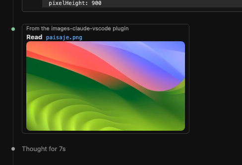

# images-claude-vscode

Mod de Claude Code que muestra imágenes dentro del chat de la extensión de VS Code.

- Las imágenes que Claude lee aparecen debajo de su fila en el chat.
- Claude puede enseñarte una imagen del disco cuando se lo pides, o cuando le parece útil.

<p align="center">
  
  <br>
  <sub>Claude lee una imagen y aparece en el chat, debajo de su fila.</sub>
</p>

## Requisitos

- macOS o Windows.
- Claude Code 2.1.327 o posterior (`claude --version`; si es anterior, `claude update`).

## Instalación

Desde la carpeta de tu proyecto, sin clonar el repositorio:

**macOS** (Terminal):

```sh
bash <(curl -fsSL https://raw.githubusercontent.com/victordiez02/images-claude-vscode/main/scripts/instalar.sh)
```

**Windows** (PowerShell):

```powershell
irm https://raw.githubusercontent.com/victordiez02/images-claude-vscode/main/scripts/instalar.ps1 | iex
```

O, con el repositorio clonado, desde su carpeta (detecta tu sistema; en Windows hace falta tener `make`):

```sh
make instalar
```

Un menú te deja elegir dónde usarlo:

- **Solo en esta carpeta** (por defecto): se activa solo en la carpeta desde la que lo ejecutas, y solo para ti.
- **Todos mis proyectos**: se activa en cualquier proyecto que abras.

Si ya lo tenías instalado, te avisa. Después, abre una conversación nueva en el chat de Claude Code de VS Code.
